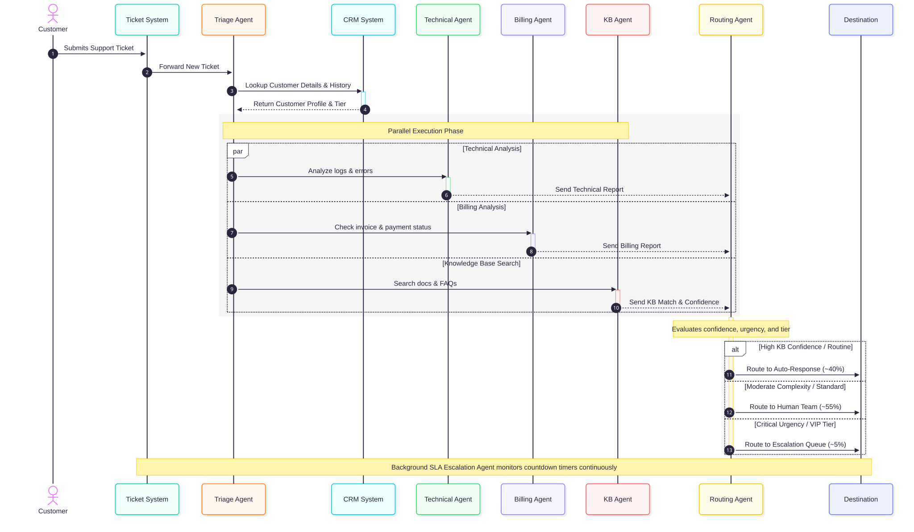

# Customer Support Ticket Routing System Architecture

Design a multi-agent system for intelligent customer support ticket handling.

## Problem Statement

Your SaaS company receives 5,000+ support tickets daily across email, chat, and web forms. Current process:
- All tickets go to L1 support
- Manual categorization and routing
- Average response time: 4 hours
- Enterprise SLA: 1 hour (frequently missed)

**Goal**: Intelligent system that automatically triages, routes, and resolves tickets.

---

## Requirements Analysis

### Functional Requirements
- Triage tickets by urgency and complexity
- Route technical issues to engineering
- Route billing issues to finance
- Prioritize by customer tier (enterprise vs. standard)
- Search knowledge base for similar solved issues
- Auto-respond to common questions
- Escalate unresolved issues to humans with context

### Non-Functional Requirements
- Enterprise SLA: < 1 hour response
- Standard SLA: < 4 hour response
- Handle 5,000+ tickets/day
- 95% routing accuracy
- Audit trail for all decisions

---

## Option A: Single Agent Approach


### Pros
- Simple implementation
- Single context (all info in one place)
- Easy to debug

### Cons
- Sequential processing (slow)
- Can't handle parallel tickets efficiently
- One agent doing too many things
- Hard to specialize for different ticket types

### Estimated Performance
- Processing time: 30-60 seconds per ticket
- Daily capacity: ~2,500 tickets (with queuing)
- SLA compliance: ~70%

---

## Option B: Multi-Agent Approach (Recommended)

<!-- TODO: Design your multi-agent architecture here -->

<!--
INSTRUCTIONS:
1. Design 4-6 specialized agents (Triage, Technical, Billing, Knowledge Base, Routing, Escalation)
2. Create a Mermaid diagram showing:
   - All agents and their relationships
   - Incoming ticket flow
   - Parallel execution paths
   - Final destinations (auto-response, human team, escalation)
3. Use the demo ARCHITECTURE.md as reference for Mermaid syntax
4. Use different colors for different agent types (see demo for style examples)
-->

> **Your task:** Fill in [`diagrams/multi-agent.mmd`](diagrams/multi-agent.mmd), then render:
> ```bash
> mmdc -i diagrams/multi-agent.mmd -o diagrams/multi-agent.svg
> ```



### Agent Definitions

<!-- TODO: Complete this table with your agent designs -->

| Agent | Responsibility | Tools | Model | Parallel? |
|-------|---------------|-------|-------|-----------|
| Triage Agent | Entry point, categorizes ticket urgency/type, and retrieves customer profile | Text Classifier, CRM API | Haiku | No (Entry) |
| Technical Agent | Analyzes system errors, bug reports, and logs for technical issues | Log Parser, Bug Tracker API | Sonnet | Yes |
| Billing Agent | Evaluates payment issues, invoice lookups, and subscription changes | Stripe API, Finance Ledger | Haiku | Yes |
| Knowledge Base Agent | Searches vector database for existing documentation and matching solutions | Vector DB Search, Doc Retriever | Haiku | Yes |
| Routing Agent | Synthesizes parallel analysis and determines the final destination path | Decision Engine, Rule Evaluator | Sonnet | No (Aggregation) |
| Escalation / SLA Agent | Background monitor tracking time-to-resolve vs enterprise/standard SLAs | DB Query, Alert Webhook | Haiku | Background (Continuous) |

<!--
HINTS:
- Triage Agent: Entry point, categorizes tickets, looks up customer
- Technical Agent: Analyzes technical issues if ticket is tech-related
- Billing Agent: Handles payment/account issues if billing-related
- Knowledge Base Agent: Always runs, searches for existing solutions
- Routing Agent: Makes final routing decision based on all analysis
- Escalation Agent: Optional background agent for SLA monitoring
-->

### Pros

<!-- TODO: List advantages of multi-agent approach -->
- Specialized Efficiency: Leverages lighter models (Haiku) for fast classifications and powerful models (Sonnet) for complex decisions.

- Parallel Processing: Drastically reduces latency by running technical, billing, and KB searches simultaneously.

- High Scalability: Modular architecture allows adding new specialist agents easily without rewriting core routing logic.

- Improved Accuracy: Multi-perspective evaluation increases routing accuracy to >95%.

### Cons

<!-- TODO: List disadvantages of multi-agent approach -->
- Architectural Complexity: Requires robust orchestration, state management, and error handling across multiple agents.

- Higher API Call Volume: Involves multiple agent hops per ticket, increasing overall token usage.

- Potential Latency Bottlenecks: Relies on the slowest parallel branch unless strict timeouts are enforced.

### Estimated Performance

<!-- TODO: Provide performance estimates -->
<!-- Consider: processing time, daily capacity, SLA compliance -->

- Processing time: 5-8 seconds per ticket

- Daily capacity: 10,000+ tickets

- SLA compliance: >98%

## Workflow Diagram

<!-- TODO: Create a detailed workflow diagram showing ticket flow from start to finish -->

<!--
INSTRUCTIONS:
1. Use Mermaid flowchart syntax
2. Show the complete ticket journey:
   - START: New ticket received
   - TRIAGE: Agent categorizes and looks up customer
   - PARALLEL: Multiple agents analyze simultaneously
   - ROUTING: Decision logic for final destination
   - DESTINATIONS: Auto-response, human team, escalation
3. Include decision points (alt/else conditions)
4. Use notes to explain key steps
5. Refer to the demo's workflow diagram for structure
-->

> **Your task:** Fill in [`diagrams/workflow.mmd`](diagrams/workflow.mmd), then render:
> ```bash
> mmdc -i diagrams/workflow.mmd -o diagrams/workflow.svg
> ```


### Sequence Diagram

<!-- TODO: Create a sequence diagram showing the interaction timeline -->

<!--
INSTRUCTIONS:
1. Use Mermaid sequenceDiagram syntax
2. Show actors and participants:
   - actor Customer
   - participant System (Ticket System)
   - participant Triage Agent
   - participant CRM
   - participant specialized agents (Tech, Billing, KB)
   - participant Routing Agent
   - participant Destination
3. Show parallel execution using 'par' blocks
4. Use 'activate' and 'deactivate' to show when agents are working
5. Use 'alt' and 'else' for conditional routing
6. Refer to the demo's sequence diagram for examples
-->

> **Your task:** Fill in [`diagrams/sequence.mmd`](diagrams/sequence.mmd), then render:
> ```bash
> mmdc -i diagrams/sequence.mmd -o diagrams/sequence.svg
> ```



---

## SLA Monitoring (Background)

<!-- TODO: Design the escalation agent for SLA monitoring -->

<!--
INSTRUCTIONS:
1. Create a Mermaid diagram showing the escalation agent
2. Define:
   - How often it runs (e.g., every 5 minutes)
   - What it checks (open tickets, time remaining vs SLA)
   - What triggers escalation (e.g., < 20% time remaining)
   - What actions it takes (alert team lead, escalate to manager)
3. List the tools it needs (Ticket System, Slack/Email alerts)
4. Choose the model (Haiku for fast, simple checks)
-->

flowchart TD
    classDef monitor fill:#f9f,stroke:#333,stroke-width:2px;
    classDef check fill:#bbf,stroke:#333,stroke-width:2px;
    classDef alert fill:#ff9,stroke:#333,stroke-width:2px;

    Start([Background Timer: Every 5 Mins]):::monitor --> Query[Query Open Tickets & SLA Deadlines]:::check
    Query --> Evaluate{Time Remaining < 20%?}:::check
    Evaluate -- No --> Wait[Continue Monitoring]:::monitor
    Evaluate -- Yes --> Escalate[Trigger High-Priority Escalation Alert]:::alert
    Escalate --> Notify[Notify Team Lead / Manager via Slack & Email]:::alert
    
> **Your task:** Fill in [`diagrams/sla-monitoring.mmd`](diagrams/sla-monitoring.mmd), then render:
> ```bash
> mmdc -i diagrams/sla-monitoring.mmd -o diagrams/sla-monitoring.svg
> ```



---

## Failure Mode Analysis

<!-- TODO: Complete the failure mode analysis table -->

| Failure | Impact | Mitigation |
|---------|--------|------------|
| Triage Agent Down | Ingestion halts; incoming tickets pile up unprocessed | Fallback to basic rule-based routing queue until service recovery |
| Technical Agent Timeout | Delayed routing decision for complex bug reports | Implement a strict 3-second hard timeout; proceed with partial analysis and flag for human review |
|Knowledge Base Search Fails | Missing contextual documentation and pre-solved answers | Gracefully degrade; skip KB insight and rely on Triage + Specialist results |
| CRM Unavailable | Cannot verify customer tier, subscription level, or account history | Temporarily assume standard tier and cache last-known profile data |
| API Rate Limits Exceeded | Dropped requests and failed downstream API calls | Implement exponential backoff, request queuing, and automatic key failover |

<!--
HINTS - Consider these failure scenarios:
- Triage Agent down
- Technical Agent slow/timeout
- Knowledge Base search fails
- CRM unavailable
- Escalation Agent crashes
- Network issues
- API rate limits

For each, think about:
- IMPACT: What breaks? What's delayed?
- MITIGATION: Fallback strategy, degraded mode, alerts
-->

---

## Recommendation

<!-- TODO: Choose Option A or Option B and justify your decision -->

**Choose Option [A or B] because:**

<!-- TODO: Provide 3-5 reasons based on:
- Volume requirements (5,000+ tickets/day)
- Speed requirements (1-hour enterprise SLA)
- Specialization needs (technical vs billing expertise)
- Scalability (easy to add new agent types?)
- Cost vs benefit trade-offs
-->
- Volume Requirements: Easily handles 5,000+ daily tickets through parallel processing and scalable micro-agent architecture.

- Speed Requirements: Meets the stringent 1-hour enterprise SLA by cutting down processing time to under 8 seconds per ticket.

- Specialization Needs: Tailors model selection (Haiku for fast lookup/triage, Sonnet for deep technical reasoning and routing) to balance quality and cost.

- Scalability & Cost-Benefit: Modular design allows seamless integration of new domain agents while maintaining high auto-resolution rates (~40%).

### Estimated Performance

<!-- TODO: Provide specific performance estimates for your chosen approach -->

- Processing time: 5-8 seconds per ticket
- Daily capacity: 10,000+ tickets
- Auto-resolution rate: 40%
- SLA compliance: 98%

---

## Key Takeaways

<!-- TODO: Write 3-4 key learnings from this architecture exercise -->

1. Parallel Execution Wins: Running specialized analysis simultaneously slashes latency and enables real-time decision making.

2. Right Model for the Job: Pairing lightweight models (Haiku) for repetitive triage and search with advanced models (Sonnet) for synthesis optimizes both cost and quality.

3. Graceful Degradation is Crucial: Multi-agent systems require robust timeouts and fallback states to prevent cascading failures.

4. Continuous Oversight: Background monitoring agents (like SLA trackers) protect high-value enterprise accounts from falling through the cracks.
